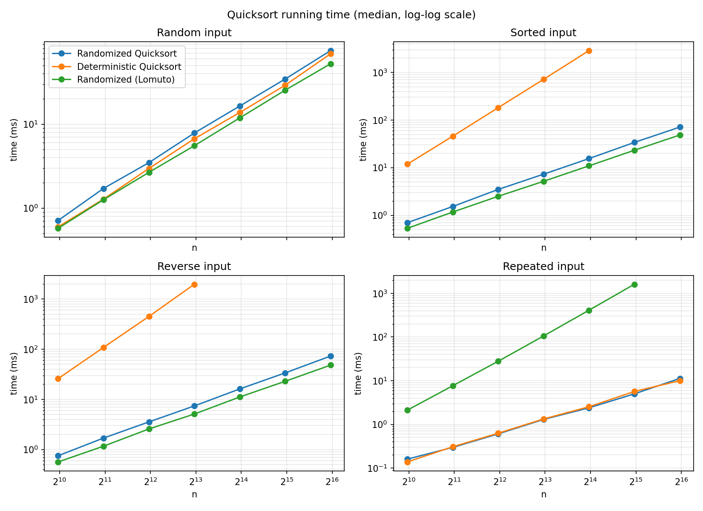
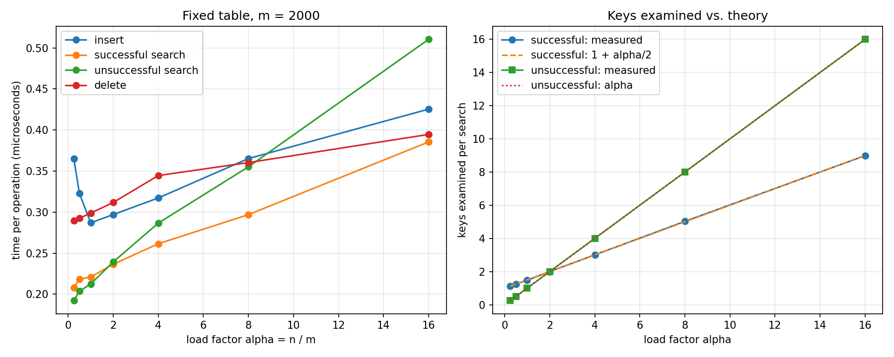
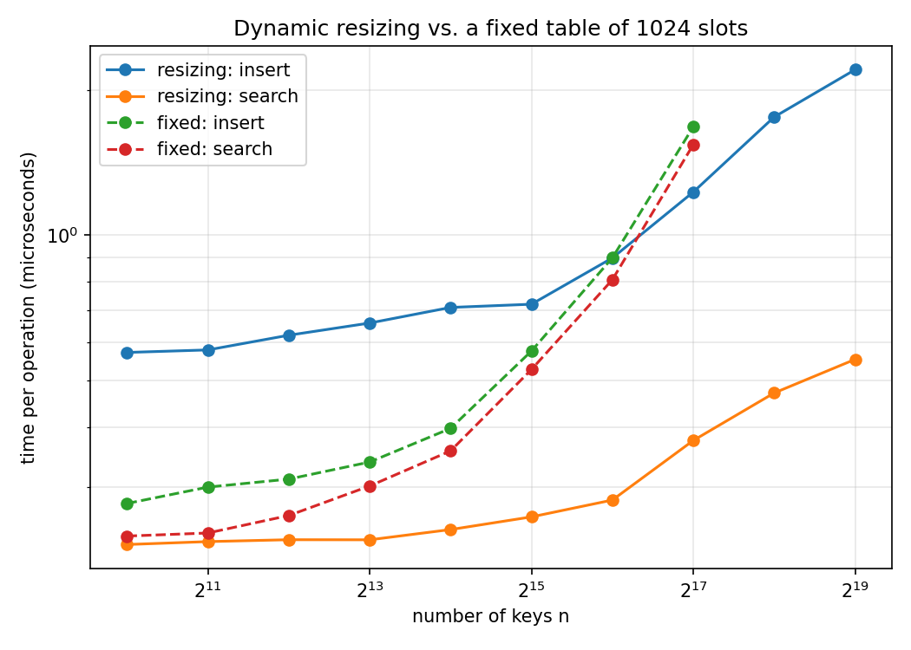
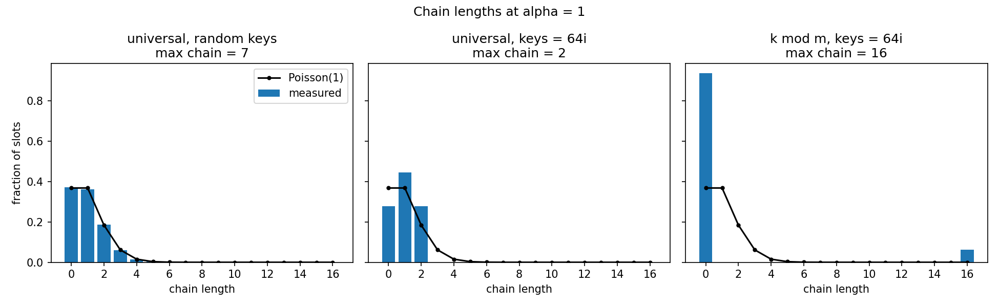

# MSCS532 Assignment 3: Randomized Quicksort and Hashing with Chaining

In this project I wrote Randomized Quicksort and a hash table with chaining in
Python, worked out their expected running times, and ran experiments to check
the math. The full write-up is in `MSCS532_Assignment3_Report.docx`.

| File | What it contains |
|---|---|
| `quicksort.py` | Randomized Quicksort (random pivot) and Deterministic Quicksort (first item as pivot), both using a three-way partition, plus a two-way Lomuto version for comparison |
| `hash_table.py` | `HashTable` class: chaining, a Carter–Wegman universal hash function, insert / search / delete, and automatic resizing |
| `test_assignment3.py` | Unit tests for both parts |
| `benchmark.py` | Timing and counting experiments; saves CSV files and graphs in `results/` |
| `results/` | CSV data, graphs, and `benchmark_output.txt` from the last full run |
| `MSCS532_Assignment3_Report.docx` | The report: implementation, analysis, results, and discussion |

## Requirements

Python 3.8 or newer. The algorithms and tests only use the standard library.
`benchmark.py` uses `matplotlib` to draw the graphs (without it, the CSV files
are still written):

```bash
pip install matplotlib
```

## How to run

```bash
python3 quicksort.py                  # short demo on each type of input
python3 hash_table.py                 # insert / search / update / delete demo
python3 -m unittest -v test_assignment3
python3 benchmark.py --quick          # small sizes, takes a few seconds
python3 benchmark.py                  # full run, takes about 3 minutes
```

Using the code in another script:

```python
from quicksort import randomized_quicksort, deterministic_quicksort
from hash_table import HashTable

data = [5, 3, 8, 3, 1]
randomized_quicksort(data)            # sorts the list in place and returns it

table = HashTable()
table.insert("apple", 3)
table.search("apple")                 # 3
table.delete("apple")                 # returns 3; raises KeyError if missing
```

## Part 1: Randomized Quicksort

**Implementation.** The pivot is picked with `random.randint(first, last)`.
The partition splits each subarray into `< pivot | == pivot | > pivot`, so all
copies of a repeated value are handled in one pass. The code only recurses on
the smaller side and loops on the bigger one, so the stack stays O(lg n) deep
even in the worst case. The tests cover empty lists, single items, sorted
lists, and lists where every item is the same.

**Analysis.** Let X_ij = 1 if the i-th and j-th smallest keys are ever
compared. They are compared only if one of them is the first pivot picked from
the keys between them, so Pr{X_ij = 1} = 2/(j − i + 1). Adding these up:

```
E[comparisons] = Σ_{i<j} 2/(j − i + 1) = 2(n+1)H_n − 4n ≈ 1.39 n lg n = O(n lg n)
```

This holds for any input. With the first item as pivot, sorted input gives
T(n) = T(n−1) + Θ(n) = Θ(n²).

**Results** (Python 3.13, Apple Silicon, median of 5 runs, n = 8,000, times in ms):

| Algorithm | Random | Sorted | Reverse | Repeated (10 keys) |
|---|---|---|---|---|
| Randomized Quicksort | 7.85 | 7.28 | 7.38 | 1.30 |
| Deterministic Quicksort (first pivot) | 6.70 | 715.0 | 1,967.2 | 1.33 |
| Randomized, two-way Lomuto | 5.54 | 5.16 | 5.09 | 105.6 |



- On sorted and reverse input, Deterministic Quicksort is Θ(n²). It makes
  exactly n(n−1)/2 comparisons, and its time goes up about 4× each time n doubles.
- Randomized Quicksort takes about the same time whatever the input order. At
  n = 64,000 its comparison count was less than 1% away from 2(n+1)H_n − 4n.
- On random input the deterministic version is a little faster, because
  calling `random.randint` for every partition is slow in Python.
- For the deterministic version, reverse input is about 3× slower than sorted
  input even though the comparison counts are the same. Items smaller than the
  pivot need a rotation with 3 writes, while larger items are not moved.
- The textbook two-way partition becomes quadratic on repeated keys even with
  random pivots, because the O(n lg n) proof assumes all keys are different.
  With the three-way partition, repeated keys are the fastest case.

## Part 2: Hash table with chaining

**Implementation.** Each slot stores a list of `[key, value]` pairs. The slot
is h(k) = ((a·k + b) mod p) mod m, where p = 2⁶¹ − 1 and a, b are random and
picked again on every resize. The table doubles when α = n/m would go above 1
and halves when α falls below 1/4.

**Analysis** (simple uniform hashing, α = n/m):

| Operation | Expected time |
|---|---|
| Unsuccessful search | Θ(1 + α): checks a whole chain, which has α keys on average |
| Successful search | checks 1 + α/2 − α/(2n) keys = Θ(1 + α) |
| Insert | Θ(1 + α) here (it looks for an existing key first), plus O(1) amortized for resizing |
| Delete | Θ(1 + α) to find the key, O(1) to remove it |

Doubling the table keeps α ≤ 1, so every operation is O(1) on average. Over
n inserts, all the rehashing together moves fewer than 2n keys.

**Results.**

- The number of keys checked per search was almost exactly what the formula
  predicts: 1.11 vs 1.12 at α = 0.25, and 8.99 vs 9.00 at α = 16.
- Time goes up with α, but slowly, because Python spends most of each
  operation on the hash calculation and the method call. An unsuccessful
  search took 0.192 µs at α = 0.25 and 0.510 µs at α = 16.
- With resizing, α never went above 1, and search took between 0.23 and
  0.55 µs while n grew from 1,024 to 524,288. A fixed table with 1,024 slots
  reached 1.54 µs at n = 131,072 (α = 128). The slow rise with resizing comes
  from CPU cache misses, not from the algorithm.
- When every key was a multiple of 64 and m = 10,000, `k mod m` used only 625
  slots, each with a chain of 16 keys. The universal hash spread the same keys
  out with a longest chain of just 2.




